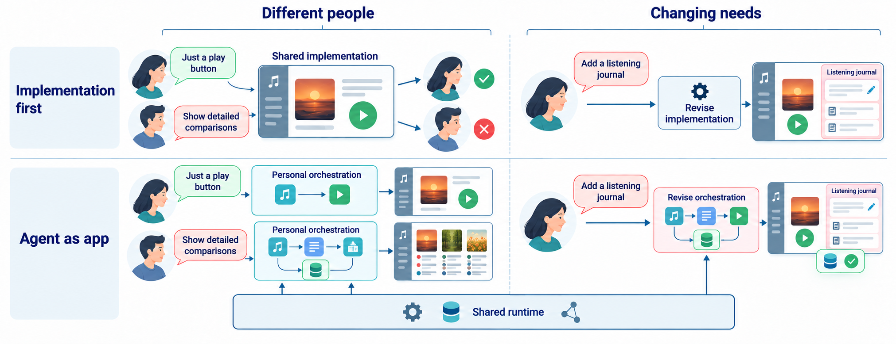

# LiveUIAgent

[Website](https://liveuibench.stonezhang.com/) | [Arxiv](https://arxiv.org/abs/2610.27977) | [LiveUIBench](https://github.com/tongmd/liveuibench) | [Deployment](deploy/README.md) | [DSH integration](packages/dsh-plugin/README.md) | [Issues](https://github.com/tongmd/liveuiagent/issues)

LiveUIAgent is an open-source runtime for personalized applications. Describe what you need, let an agent create the interface and behavior, and revise the application while keeping its saved state. A shared runtime connects the interface, memory, and service actions.




## Get Started

Requires Node.js 22.19 or later and npm. Linux and macOS are supported by the local workflow.

```bash
git clone https://github.com/tongmd/liveuiagent.git
cd liveuiagent
npm ci --workspace @liveuiagent/dsh-plugin --include-workspace-root
cp .env.example .env
npm run build
npm start
```

Open `http://127.0.0.1:8787`. In Settings, choose a model, configure an OpenAI-compatible API endpoint and key, then describe an application. For example:

> Create a reading tracker with books, notes, and a weekly reading goal.

After using it, ask for a revision:

> Add a filter for unfinished books and keep my existing notes.

Model requests use your configured provider. No model API calls are needed for the offline tests.

## Features

- Application generation and revision through natural-language requests.
- A shared runtime for interfaces, persistent data, tools, and service actions.
- Model and harness selection through the application settings.
- Memory for saved preferences and context.
- Background job scheduling, status, and cancellation.
- Browser-based application evaluation and an AppWorld integration.

## Supported Harnesses

| Harness | Application representation | Configuration |
| --- | --- | --- |
| Native | Application specifications rendered by the shared runtime | Included in the local runtime |
| DeepSeek Harness | HTML applications with storage and AI bridges | Configure a DSH service, or install the [DSH plugin](packages/dsh-plugin/README.md) |

The web interface is included. The `apps/shell` directory contains the React Native shell; its platform tooling is installed separately when needed.

## Configuration

Start with [.env.example](.env.example). Storage paths are local and ignored by Git. Keep real credentials in your environment or local `.env`.

| Setting | Purpose |
| --- | --- |
| `PORT`, `HOST` | Local HTTP listener |
| `DB_PATH` | Persistent SQLite database |
| `GENERATED_APPS_DIR` | Generated application storage |
| `OPENAI_API_BASE`, `OPENAI_API_KEY` | Model provider connection |
| `LIVEUIAGENT_ORCHESTRATOR_MODEL` | Default orchestration model |
| `LIVEUIAGENT_DSH_API_BASE` | Optional DSH service endpoint |

The application settings can override provider settings for the current user. `liveuiagent.config.json` configures optional service and evaluator integrations. For a hosted installation with authentication and persistent storage, follow the [deployment guide](deploy/README.md).

## Development and Contributing

```bash
npm run dev
npm test
npm run check:docs
npm run check:release
```

The frontend source bundle is in `frontend/snapshot/`. After reviewing a frontend change, run `node scripts/update-frontend-manifest.mjs` before building. Set `CHROME_PATH` to run the browser checks:

```bash
npm run test:runtime-ui
npm run test:driver
npm run test:evaluator
npm run test:catalog
```

Bug reports should include the Node version, harness, reproduction steps, and relevant redacted logs. For changes, open a pull request with a focused description and the checks you ran. Do not include credentials, private deployments, or user application data.

## Evaluation

[LiveUIBench](https://github.com/tongmd/liveuibench) maintains the evaluation dataset, isolated runners, and metrics. It pins this runtime as a Git submodule. Use that repository for benchmark runs and the evaluation protocol.

## Citation

```bibtex
@misc{zhang2026liveuibench,
  title = {{LiveUIBench}: Evaluating Agent as App Workflows},
  author = {Zhang, Tong and Cheng, Yuxuan and Zhang, Ruimin and Peng, Yun and Xie, Tao},
  year = {2026},
  eprint = {2610.27977},
  archivePrefix = {arXiv},
  primaryClass = {cs.SE},
  url = {https://arxiv.org/abs/2610.27977}
}
```

[BibTeX](citation.bib) · [CITATION.cff](CITATION.cff). Code is licensed under [Apache-2.0](LICENSE).
