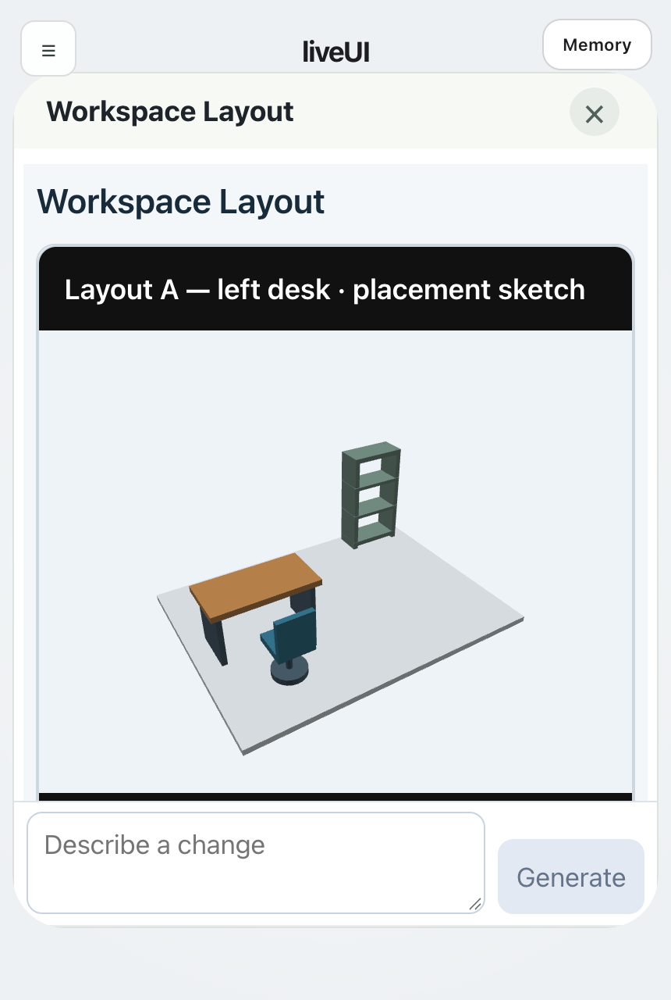
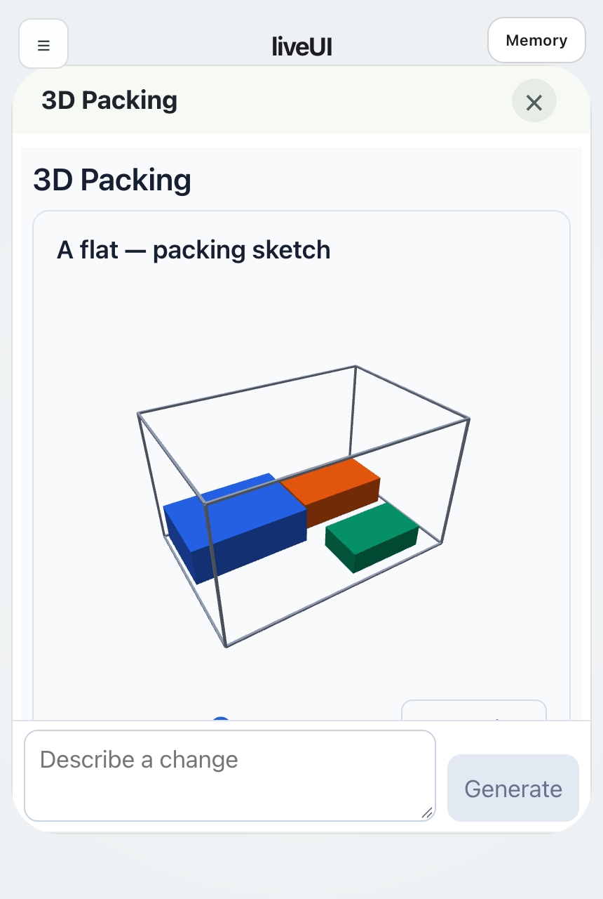
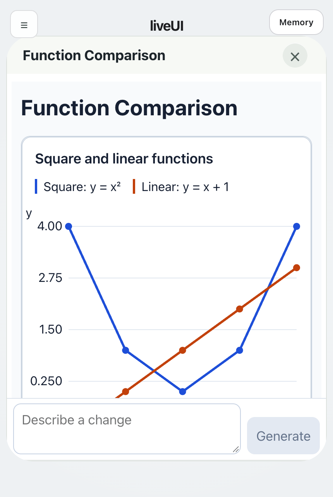
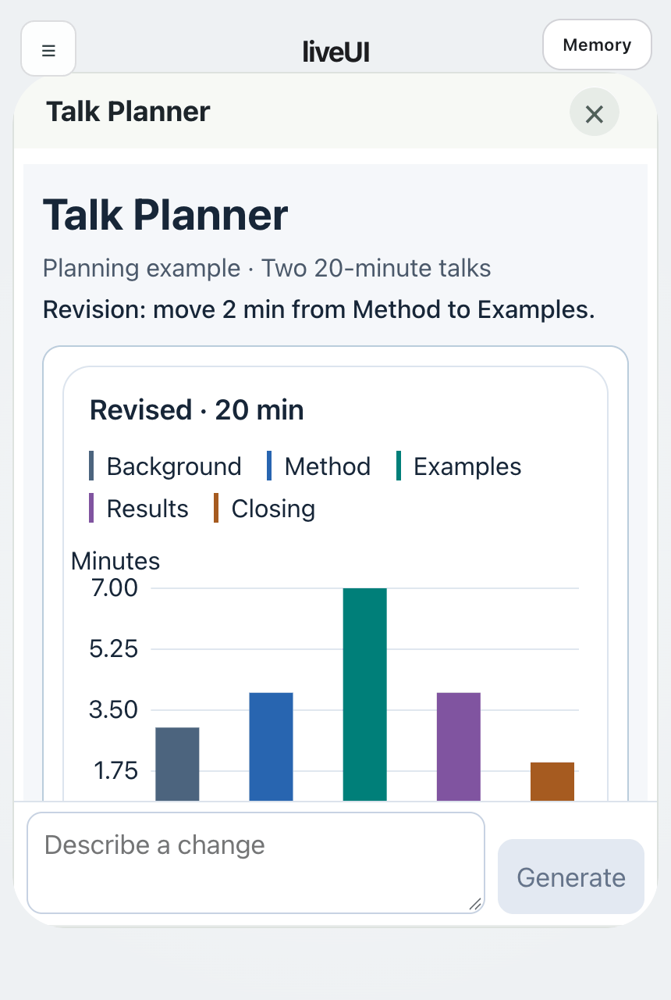

# LiveUIAgent

[Join the waitlist](https://docs.google.com/forms/d/e/1FAIpQLSckrULbwm5t1j0UiV7KwVIUwq2-qsMnI4pkikL7Ii1J6K55QA/viewform) | [Product](https://guios.stonezhang.com/) | [Paper website](https://liveuibench.stonezhang.com/) | [Arxiv](https://arxiv.org/abs/2610.27977) | [LiveUIBench](https://github.com/tongmd/liveuibench) | [Deployment](deploy/README.md) | [DSH integration](packages/dsh-plugin/README.md) | [System design](SYSTEM_DESIGN.md) | [Issues](https://github.com/tongmd/liveuiagent/issues)

LiveUIAgent is an open-source runtime for personalized applications. Describe what you need, let an agent create the interface and behavior, and revise the application while keeping its saved state. A shared runtime connects the interface, memory, and service actions.

## Philosophy

The user is the developer. Context is the software.

Our goal is to make software development part of everyday use. Users shape their applications by expressing intent and building context through conversations, data, preferences, and interactions. That context guides how an application works and how it evolves.


## Applications

Four independent applications generated with Codex: Workspace Layout, 3D Packing, Function Comparison, and Talk Planner. Rotate the 3D views, select chart points and diagram nodes, and reopen an application with its saved state.

<p>
  <a href="assets/demos/workspace-layout.gif"></a>
  <a href="assets/demos/3d-packing.gif"></a>
</p>
<p>
  <a href="assets/demos/function-comparison.gif"></a>
  <a href="assets/demos/talk-planner.gif"></a>
</p>

## Get Started

Requires Node.js 22.19 or later and npm. Linux and macOS are supported by the local workflow.

```bash
git clone https://github.com/tongmd/liveuiagent.git
cd liveuiagent
npm ci --workspace @liveuiagent/dsh-plugin --include-workspace-root
cp .env.example .env
npm run build
npm start
```

Open `http://127.0.0.1:8787`. In Settings, choose a model, configure an OpenAI-compatible API endpoint and key, then describe an application. For example:

> Create a reading tracker with books, notes, and a weekly reading goal.

After using it, ask for a revision:

> Add a filter for unfinished books and keep my existing notes.

Model requests use your configured provider. No model API calls are needed for the offline tests.

## Features

- Application generation and revision through natural-language requests.
- A shared runtime for component interfaces, persistent data, tools, and service actions.
- Separate agent-role invocations, validated handoffs, independent result review, and persistent execution records.
- Model and harness selection through the application settings.
- Memory for saved preferences and context.
- Background job scheduling, status, and cancellation.
- Browser-based application evaluation and an AppWorld integration.

## Supported Harnesses

| Harness | Application representation | Configuration |
| --- | --- | --- |
| LiveUIAgent (native) | Application specifications rendered by the shared runtime | Included in the local runtime |
| Codex | Native component specifications with Codex reasoning and host-managed actions | Configure an authenticated Codex inference relay |
| DeepSeek Harness | Native component specifications with DSH-backed agent reasoning | Set `LIVEUI_NATIVE_DSH_COMMAND` to an installed DSH CLI |
| Qwen Code | Native applications and visual workspaces using the configured Qwen API model | Official Qwen Code CLI |
| Kimi Code | Native applications and visual workspaces using the configured Kimi API model | Official Kimi Code CLI |
| ZCode | Native applications and visual workspaces using the configured GLM API model | Official ZCode CLI |

See [harness installation](deploy/domestic-harnesses.md) and the [complete system design](SYSTEM_DESIGN.md).

All six harnesses use the same visual workspace runtime: interactive 3D scenes, line/scatter/bar plots, dependency diagrams, responsive layouts, and saved interaction state. The selected harness generates and revises the component tree; the host validates it and preserves the previous version if delivery fails. LiveUIAgent's native harness also generates these workspaces with its configured model, including 3D room layouts and project diagrams.

New applications use A2UI component specifications. Agent roles pass validated contracts to a host executor, which owns permitted service calls and commits reviewed state. Existing HTML applications remain supported; API callers can explicitly request `delivery: "html"` for the [HTML plugin](packages/dsh-plugin/README.md) path.

The web interface is included. [Android and iOS projects](apps/mobile/README.md) package the full hosted workspace with native connection and secure credential storage. The earlier `apps/shell` React Native prototype renders a limited component subset and is not the mobile release target.

## Configuration

Start with [.env.example](.env.example). Storage paths are local and ignored by Git. Keep real credentials in your environment or local `.env`.

| Setting | Purpose |
| --- | --- |
| `PORT`, `HOST` | Local HTTP listener |
| `DB_PATH` | Persistent SQLite database |
| `GENERATED_APPS_DIR` | Generated application storage |
| `OPENAI_API_BASE`, `OPENAI_API_KEY` | Model provider connection |
| `LIVEUIAGENT_ORCHESTRATOR_MODEL` | Default orchestration model |
| `LIVEUIAGENT_CODEX_BASE_URL`, `LIVEUIAGENT_CODEX_TOKEN` | Server-only Codex inference relay URL (ending in `/v1`) and bearer token |
| `LIVEUIAGENT_CODEX_ALLOWED_USERS` | Optional comma-separated account allowlist; unset allows authenticated users |
| `LIVEUIAGENT_CODEX_MODEL` | Relay model, default `gpt-6-astra`; independent of provider model settings |
| `LIVEUIAGENT_CODEX_TIMEOUT_MS`, `LIVEUIAGENT_CODEX_MAX_CONCURRENT` | Codex inference deadline (default 180000 ms) and capacity (default 2) |
| `LIVEUI_NATIVE_DSH_COMMAND`, `LIVEUI_NATIVE_DSH_ARGS` | DSH reasoning executable and optional JSON argument array |
| `LIVEUI_NATIVE_DSH_TIMEOUT_MS`, `LIVEUI_NATIVE_DSH_MAX_CONCURRENT` | Per-inference deadline and concurrent-worker limit |
| `LIVEUIAGENT_DSH_API_BASE` | Optional service endpoint for existing or explicit HTML applications |

Codex appears in the harness selector when its server connection is configured. The relay must provide an inference-only `POST /v1/chat/completions` endpoint and manage its Codex login on the relay host. It must disable file, shell, network, MCP and delegated-agent execution; LiveUIAgent retains all application actions. Use HTTPS or a loopback tunnel. The Codex model is fixed by the server, and existing apps retain their selected harness.

The application settings can override provider settings for the current user. `liveuiagent.config.json` configures optional service and evaluator integrations. For a hosted installation with authentication and persistent storage, follow the [deployment guide](deploy/README.md).

## Development and Contributing

Administrators can ask the selected harness to modify liveUI itself. The harness reads the project and related app history, edits source, and runs configured tests in a persistent development workspace. Explicit continuation requests retain the same conversation and edits. Responses include the actual diff and test results. An installation can enable automatic deployment for selected owners: tested changes enter an independent review and deployment queue, with version checks, backups, and rollback on failed deployment checks. The original conversation shows the recorded deployment outcome. Changes outside the configured deployment scope remain in the workspace with a specific reason.

```bash
npm run dev
npm test
npm run check:docs
npm run check:release
```

The frontend source bundle is in `frontend/snapshot/`. After reviewing a frontend change, run `node scripts/update-frontend-manifest.mjs` before building. Set `CHROME_PATH` to run the browser checks:

```bash
npm run test:runtime-ui
npm run test:driver
npm run test:evaluator
npm run test:catalog
```

Bug reports should include the Node version, harness, reproduction steps, and relevant redacted logs. For changes, open a pull request with a focused description and the checks you ran. Do not include credentials, private deployments, or user application data.

## Evaluation

[LiveUIBench](https://github.com/tongmd/liveuibench) maintains the evaluation dataset, isolated runners, and metrics. It pins this runtime as a Git submodule. Use that repository for benchmark runs and the evaluation protocol.

## Citation

```bibtex
@misc{zhang2026liveuibench,
  title = {{LiveUIBench}: Evaluating Agent as App Workflows},
  author = {Zhang, Tong and Cheng, Yuxuan and Zhang, Ruimin and Peng, Yun and Xie, Tao},
  year = {2026},
  eprint = {2610.27977},
  archivePrefix = {arXiv},
  primaryClass = {cs.SE},
  url = {https://arxiv.org/abs/2610.27977}
}
```

[BibTeX](citation.bib) · [CITATION.cff](CITATION.cff). Code is licensed under [Apache-2.0](LICENSE).
