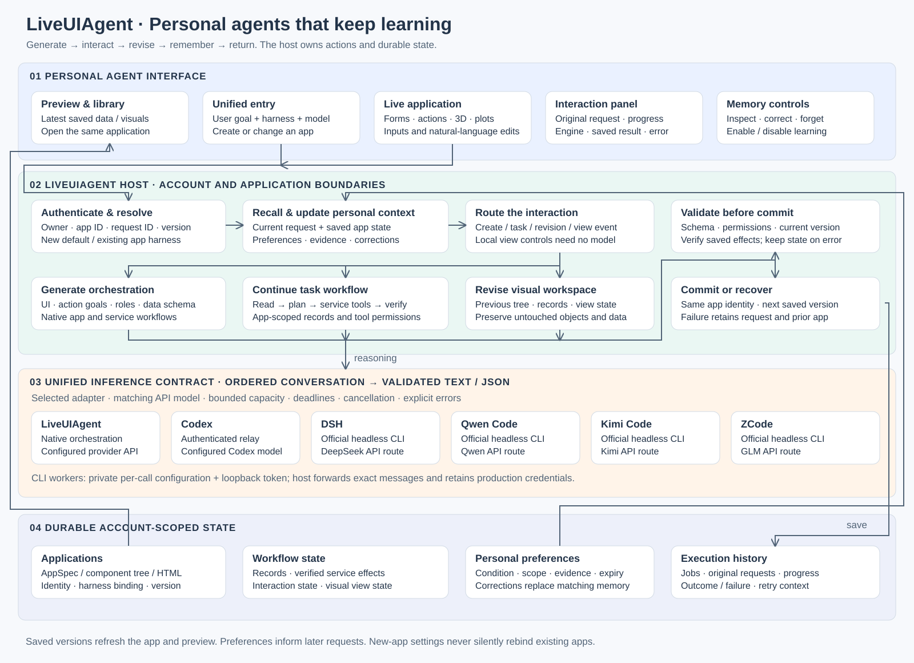
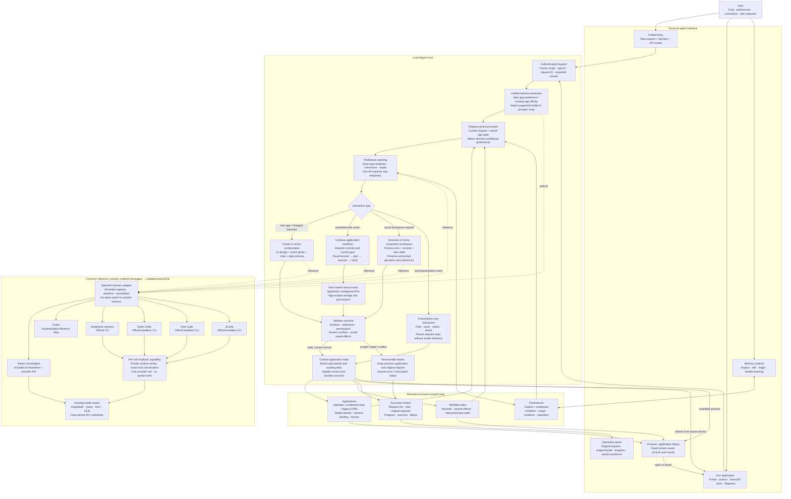

# LiveUIAgent system design

LiveUIAgent implements **Agent as App**: a personal agent creates an interactive workspace, continues to interpret the user's inputs through that workspace, and revises its interface and behavior while preserving application identity and saved information.

The same account, preferences, application state and interaction history are used across the native runtime and the supported external harnesses. A harness selects the reasoning engine. The host retains ownership of application actions, service connections, validation and persistence.

[Open the full-size diagram](assets/system-design.svg). The detailed interaction graph follows.

## Alignment with the paper

The design follows the Agent as App task definition and the “Generate orchestration” method section of *LiveUIBench: Evaluating Agent as App Workflows*. The original source describes a continuing application-side agent that interprets inputs and retained information, performs service operations, and updates visible state. It also explicitly allows presentation-only events without model calls.

| Product requirement | Implementation and acceptance condition |
| --- | --- |
| The personal agent generates UI during interaction | Creation, task actions and revision produce a validated interface from the current goal and state. Preview and reopened views show saved application information. |
| UI reflects preferences and records them | Explicit memory and evidence-grounded contextual memory are account-scoped. Generation receives relevant conditions. Corrections update the matching preference; a one-time request does not become a permanent habit. |
| Workflows continue and adjust over time | App identity, records, interaction state and harness binding survive revision and reopening. Native actions execute through the existing orchestration and permitted tools. Failure retains the prior valid application. |
| One entry for all harnesses, including native LiveUIAgent | Runtime settings resolve the selected engine and matching API model. Existing applications retain their original engine. Preference learning, appearance generation, GUI planning and UI generation respect that resolution. |

## Lifecycle and state ownership

1. **Preview.** Gallery cards read persisted content. A thumbnail never executes a service operation or starts model inference. Cache keys include application version and update time.
2. **Creation.** The host resolves identity, harness and model, prepares personal context, generates the orchestration or component workspace, validates it and persists a durable result.
3. **Interaction.** Submitted task inputs go to the application-side agent with saved context. The host executes permitted service calls and verifies their results. Local visual controls update view state directly.
4. **Revision.** The latest user instruction has priority over remembered defaults. Component edits receive the previous tree and exact visual references. Native workflow changes retain application identity and data.
5. **Return visit.** The application restores saved state. Preference and harness changes for new apps do not silently replace the engine used by an existing app.
6. **Failure and retry.** Jobs keep the original request and error. Duplicate workspace request IDs return the same job. Version checks reject stale writes. An interrupted operation is not reported as successful or automatically replayed.

## Harness integration

| Entry | API model family | Runtime configuration |
| --- | --- | --- |
| LiveUIAgent | Any configured supported model | Included |
| Codex | Server relay model | `LIVEUIAGENT_CODEX_*` |
| DSH | DeepSeek | `LIVEUI_NATIVE_DSH_*` |
| Qwen Code | Qwen | `LIVEUI_QWEN_COMMAND`, `LIVEUI_QWEN_ARGS` |
| Kimi Code | Kimi / Moonshot | `LIVEUI_KIMI_COMMAND`, `LIVEUI_KIMI_ARGS` |
| ZCode | GLM | `LIVEUI_ZCODE_COMMAND`, `LIVEUI_ZCODE_ARGS` |

The new entries are advertised only when the configured API model list contains the matching model family. A matching model with no installed runtime is shown as unavailable. Switching harness saves the corresponding model preference in the same database transaction.

External CLIs run as inference workers in this integration. LiveUIAgent supplies the orchestration, business tools, personal memory and persistence. This does not expose every standalone vendor CLI tool to application users. Each worker gets a private temporary configuration and a short-lived local provider token; production API credentials remain in the host. Pinned CLI versions are documented in [deployment instructions](deploy/domestic-harnesses.md).

## Implementation map

| Responsibility | Source |
| --- | --- |
| Model families, labels and registered IDs | [harness-catalog.ts](server/harness-catalog.ts) |
| Per-account selection and existing-app affinity | [runtime-settings.ts](server/runtime-settings.ts), [native-harness.ts](server/native-harness.ts) |
| Official Qwen/Kimi/ZCode workers | [domestic-harness-inference.ts](server/domestic-harness-inference.ts) |
| Provider capability and ordered messages | [dsh-native-relay.ts](server/dsh-native-relay.ts) |
| Context preparation, appearance, memory controls | [personalization.ts](server/personalization.ts) |
| Conditional memory and evidence validation | [contextual-memory.ts](server/contextual-memory.ts) |
| Native orchestration and persistent actions | [liveuiagent.ts](server/liveuiagent.ts), [native-workflow.ts](server/native-workflow.ts) |
| Persisted visual workspaces | [rich-workspaces.ts](server/rich-workspaces.ts), [structured-ui.ts](server/structured-ui.ts) |
| Existing HTML applications and service bridge | [complete-apps.ts](server/complete-apps.ts) |
| Interaction receipts and UI changes | [app-activity.ts](server/app-activity.ts) |
| Unified selector and previews | [runtime-controls.js](frontend/snapshot/runtime-controls.js), [gallery-cards.js](frontend/snapshot/gallery-cards.js) |

## Verified scope and remaining boundaries

The native AppSpec path supports agent-mediated service workflows. The rich workspace path supports persistent visual applications, natural-language revisions and visual controls. A component workspace does not itself supply arbitrary service actions; service work remains on the native orchestration or existing HTML service path. The two delivery paths share harness resolution and personal context, but they are not yet a single application representation.

Long-term use here means retaining application identity, user preferences, workflow records and revision state across visits. It does not mean every application runs a recurring autonomous background task. Recurring schedules and cross-application workflow migration need their own explicit product contracts and acceptance tests.

The test matrix and observed outcomes are maintained in [system validation](docs/system-validation.md). Deterministic lifecycle tests validate persistence and dispatch; real-model tests separately validate runtime and API compatibility. Neither alone establishes arbitrary application reliability.

## References

- [Paper](https://arxiv.org/abs/2610.27977)
- [LiveUIBench](https://github.com/tongmd/liveuibench)
